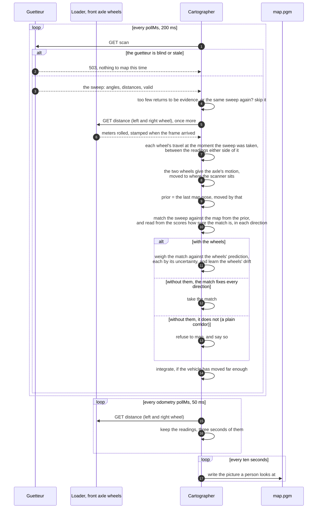

# cartographer

Consumes sweeps from a [guetteur](../guetteur) and builds an occupancy map,
working out as it goes where each sweep was taken from.

It maps and it localizes; it does not drive. Between sweeps it reads how far
the [loader](../loader)'s wheels have turned, and matches each sweep against the
map built so far starting from there. Without the wheels it starts from constant
velocity instead, and refuses to map where the view alone cannot place it.

## Services

| service | form | what it is |
|---|---|---|
| `map` | `MapA_v1a` | the occupancy grid built so far: each cell unknown, or the probability in percent that it is occupied |
| `pose` | `PoseA_v1a` | where in the map the sensor is believed to be |
| `coverage` | `SignalA_v1a` | the share of the grid that has been observed at all |

**Each run is its own map.** The origin is wherever the first sweep was taken,
so after a restart the same coordinates name another place. The `map` and `pose`
forms carry the run in their frame — `map@2026-09-27T06:13:50Z`, the start time —
and anything planned in one run, like a [navigator](../navigator/) route, must be
refused in another.

A `map.pgm` is also written to disk every ten seconds. That is the artifact a
person looks at; the `map` service is what a system consumes.

**The map says how sure it is.** Each cell keeps the evidence for and against
its being occupied as log-odds — an occupancy grid in Elfes' sense: every
return that ends in it is evidence for, every beam that passes through it
evidence against. The `map` service sends that as a probability, 0 to 100
percent, and the picture shades it, white for surely free to black for surely
occupied, with the never-observed in the usual mid grey. A wall struck once is
70 % and a light grey; one struck on every pass is 99 % and black. The first
version cut at even odds and sent only free or occupied, so a stray return was
as black as the corridor's wall, and no consumer could ask for more certainty.
Evidence for a wall never rounds below 50 and evidence against it never above
49, so a consumer that cuts at 50, as the [navigator](../navigator/) does by
default, reads the map exactly as before.

## One sweep, start to finish

## What it is, and what it is not

This is a SLAM **front end**. There is no pose graph and no loop closure, so a
long circuit of a building will not snap shut when it returns to where it
started — the drift accumulated on the way round simply stays. For a hallway
driven up and back, which is the experiment the students are being given, that
is the right amount of machinery.

## Three things that are not obvious, and were each found by a failing test

**1. Walls must be recorded as surfaces, not points.** A sweep samples a wall at
intervals that grow with range, so recording only beam endpoints leaves a wall
as a row of dots. A later sweep then scores best by dropping its endpoints back
into those same dots — which is the pose the vehicle has already left. The
matcher fits the sampling pattern instead of the geometry and reports that
nothing has moved. `integrate` therefore joins adjacent returns that are within
30 cm of each other, and the range jump at a doorway is what stops it drawing a
wall across the opening.

**2. Matching scores against a distance transform, not the occupancy grid.**
A Euclidean distance field makes a wall uniformly attractive along its length,
so the along-wall direction carries no false evidence.

**3. A straight corridor cannot say how far along it you are.** Two parallel
walls look identical from everywhere between them. This is the aperture problem
and it is a property of the geometry, not a defect to be tuned away.

So the match comes with its uncertainty: how sure it is in every direction,
read from the scores themselves, as Olson does for correlative scan matching
(*Real-time correlative scan matching*, ICRA 2009, §F). The coarse search has
scored the whole window; a Gaussian fitted to those scores says in which
directions the fit falls off at all. One that spreads across the window — along
a corridor — is not seen, and the match says nothing there. The fine search,
close round the peak, says how precisely the seen directions are fixed. The two
are read at different scales on purpose. Across the window the scores are read
loosely, a fit 5 % worse being *e* times less likely, because a sweep's own
sampling pattern and the ends of walls not yet drawn move the score by a few
percent wherever it is put, and read tightly those few percent pin the vehicle
to where the walls' dots were last drawn. Round the peak the score is read as
the log-likelihood it is, or else the walls would fix the heading only to a
degree and the wheels would outweigh them.

Then:

- **with odometry**, the match and the wheels' prediction are weighed by their
  uncertainties, in a Kalman filter on the pose (`fusion.go`). In a corridor
  the walls decide the heading and the distance to them, and the wheels the
  distance along it; a doorway half seen counts for what it is worth; no
  threshold decides which source wins. The filter also learns the wheels'
  **drift**, the turn they report per meter that never happened — two wheels of
  slightly different size do that every meter, the same way — and takes it out
  of every step after; see below;
- **without odometry**, a sweep the match does not fix in every direction is
  *not* integrated at all, and the system says so. A corridor mapped from a
  pose that cannot be known comes out the wrong length and looks entirely
  convincing.

The versions before took decisions where this weighs. The first took the
wheels' pose whole wherever the peak was flat, heading included, and so threw
away the walls exactly where they hold the heading best. The second took the
heading from the walls in a corridor and the distance from the wheels, but
judged "flat" by nudging along x and y, and a corridor at an angle to the map's
axes passed as sharp; the matcher then slid along it. In `corridor_test.go`,
with one wheel reading 2 % long over 20 m of corridor, the first turned the map
36°; this one ends 0.2° off, and has learned the 1.8°/m the wheels report.

## Odometry

**The consumed services are the loader's wheel `distance`** — meters rolled by
the two wheels of the scanner's own axle, found by definition `distance`, the
wheel's `NodeID` and the vehicle's `Model`. Between two sweeps the change in
each says how far each side moved. The wheel's size is the loader's business:
it converts revolutions to meters with the circumference in its own
configuration, one circumference per wheel, so the wheel sizes are calibrated there.

**One axle is enough, and the articulation angle is not needed.** An
articulated loader bends in the middle, so its two halves point in different
directions; but each half is a rigid body on two wheels that do not slide
sideways, which is exactly a differential-drive robot. Its axle moves at the
mean of the two wheel speeds and turns at their difference over the track. So
the cartographer tracks the half the scanner is mounted on, from that half's
wheels, and does not need the waist sensor.
The motion is integrated as an arc, and moved from the axle's center to where
the scanner sits (`scannerMount`).

**The motion is applied to the map, not the odometry's position.** The wheel
counters start from wherever the loader was switched on; the map starts from
the first sweep. The prior for each sweep is the previous map pose moved by the
wheels' change. (The first version used an odometry pose directly as the map
pose, and would also have discovered its *own* `pose` service as the odometry
source. Neither ever ran, because nothing provided a pose.)

**Where the view cannot place the vehicle, the wheels do.** Down a plain
corridor the match says nothing along it, and the distance is the wheels'.
`odometry_test.go` drives a simulated corridor: with the wheels the estimate
follows the vehicle to the centimeter; without them every sweep is refused.

**How sure the wheels are** is the `odometry.noise` setting: one standard
deviation of each step's error, growing with the step. The defaults are 3 % of
the distance along it, 2 % sideways, 1.5° per meter of turn that never happened,
and 10 % of every turn, the scrubbing of the tires. They are what the view is
weighed against, so they matter less than they look: too confident, and the
wheels' errors reach the map; too doubtful, and every flutter of the match
does.

**The drift the filter learns** is logged every 300 sweeps once it is known to
a quarter of a degree per meter: *the wheels report +0.4°/m (±0.15) of turn that
the walls do not see.* Positive means a turn to the left: the right wheel reads
long or the left one short. It is the wheel-size difference left after the
loader's per-wheel circumferences, the same thing a clockwise and
counterclockwise loop (UMBmark) measures. A value that stays well away from
zero says those circumferences are off.

**What the wheels get wrong, and what guards against it:**

- *Slip.* The loader drives each wheel at the speed the geometry asks for, but
  tires still creep and scrub, most in tight turns, so the heading from the
  encoders drifts. What is the same every meter the filter learns as drift;
  the rest is noise, and the view outweighs it wherever it sees.
- *Counter wrap.* The encoder's own counter wraps every 204.8 revolutions; the
  loader unwraps it, so `distance` does not.
- *A loader restart* starts the distances again from zero. A jump larger than
  `maxWheelSpeedMetresPerSecond` allows in the time between readings is taken
  as a restart, not motion, and logged.
- *A dead encoder.* The loader re-sends its latest reading once a second even
  when nothing changes, stamped with when it arrived. A reading older than
  `maxAgeMs` (1.5 s) is not used. The loader and the cartographer must
  therefore agree on the time to within that — run NTP if they are on different
  hosts.
- *Timing.* The wheels are read every `pollMs` and once more for each sweep,
  each reading kept with the time the loader received it, and the travel used
  is interpolated at the sweep's own timestamp. The first version read them
  when it got round to the sweep, a delay that varies from sweep to sweep and
  over Wi-Fi by hundreds of milliseconds; down a corridor that variation went
  straight into the distance. This assumes the guetteur and the loader agree on
  the time, which they do on the same computer. Two things remain: the
  guetteur stamps a sweep when it ends rather than in its middle, and a sweep
  is not de-skewed for the motion during it, which bends a sweep taken while
  turning.

| `odometry` field | default | |
|---|---|---|
| `enabled` | true | absent means true |
| `vehicle` | `{"Model": ["artitrax"]}` | picks the loader |
| `leftNodeID` / `rightNodeID` | 1 / 2 | the **front** axle; 3 / 4 for the back |
| `trackMetres` | 0.6275 | measured |
| `scannerMount` | 0, 0, 0° | forward, left, and yaw of the scanner from that axle's center |
| `maxAgeMs` | 1500 | longer than the loader's one-second heartbeat |
| `maxWheelSpeedMetresPerSecond` | 3 | bounds plausible motion between readings |
| `pollMs` | 50 | how often the wheels are read between sweeps |
| `noise` | 0.03, 0.02, 1.5, 0.1 | `alongFraction`, `crossFraction`, `headingDegreesPerMeter`, `turnFraction`: one standard deviation of a step's error |

**Check the defaults against the vehicle:** they assume the SF45/B is on the
**front** half, over the axle, facing forward. If it is mounted elsewhere, say
so in `scannerMount`, and pick the axle it is on.
