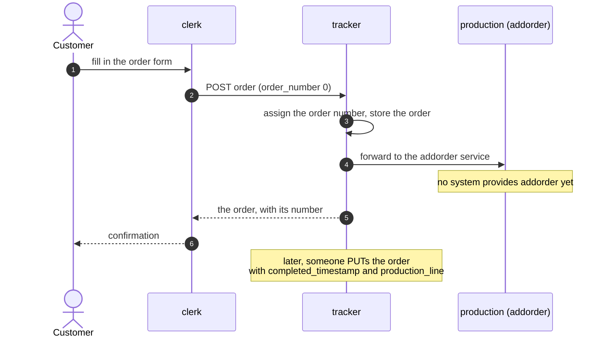

# mbaigo System: comptroller

**Status: proposal, not built.** Written 26 October 2026 for discussion. There is
no code here, and the system is deliberately absent from the Makefile's
`SYSTEMS` list until it exists.

The comptroller would keep the accounts of a local cloud: what happened, case
by case, in what order, how long it took and what it cost, and it would show
that as a BPMN process.

---

## Three views of one cloud

Two systems already describe a running local cloud, each in a standard
language and each built from what the systems themselves declare. Neither is
drawn by hand.

| system | language | the question it answers |
|---|---|---|
| [`kgrapher`](../kgrapher/) | RDF, the Arrowhead Framework Ontology | what exists, and how is it related? |
| [`modeler`](../modeler/) | SysML v2 | how is it engineered, and which requirements does it meet? |
| **comptroller** | BPMN 2.0 | what happens, in what order, how long does it take, and what does it cost? |

The first two describe structure. The third would describe behavior over
time, which is a different kind of knowledge: a system can declare which
services it offers, but not the order in which a customer's order passes
through them. That has to be observed.

## What it is, and what it is not

- **It observes; it does not execute.** BPMN is usually the input of a workflow
  engine, which then drives the work. Here it is the output: the process as it
  actually ran, recovered from what the systems recorded. Whether the
  comptroller should ever drive a process is a question for later (see the
  questions at the end); an Arrowhead cloud already decides who serves whom at
  run time, through the orchestrator, and a second authority over the order of
  work would compete with it.
- **It is not the books.** It does not replace an accounting or ERP system. It
  produces what such a system needs: the cost of each case, and the quantities
  to bill.
- **It is not the [chronicler](../chronicler/README.md).** The chronicler, also
  unbuilt, would carry the cloud's events out to a plant's Kafka backbone. The
  comptroller would read events to reason about cases. They should share the
  same event records, not duplicate them.

The name is the old title of the officer who audits expenditure. It also keeps
clear of "controller", which already means something else next to a control
loop and to Arrowhead's orchestrator.

---

## First use case: the pen holder

The pen-holder order is the one process in the repository that is already
built around cases. A customer orders a pen holder of given dimensions; the
order is recorded; production is meant to take it from there.

[`clerk`](../clerk/README.md) is the customer's way in: a web form that
validates the order and hands it on. It stores nothing.

### Why the tracker matters most

The [`tracker`](../tracker/README.md) is where the comptroller would start,
for four reasons.

1. **It mints the case identifier.** Process mining needs every event to say
   which case it belongs to. The order number is that identifier, and the
   tracker assigns it. No other system in the cloud has a natural one.
2. **It is the system of record.** Every change to an order passes through it:
   creation by the clerk, assignment to a production line, completion. Those
   changes are the process's steps.
3. **Today it forgets the history.** A `PUT` overwrites the order. What remains
   is the order's latest state and two timestamps, ordered and completed. The
   steps between are lost, and a process cannot be recovered from its end
   states alone. This is the first thing to change.
4. **It shows the gap.** It forwards each new order to an `addorder` service,
   and no system provides one. Completion is entered by hand. A process model
   mined today would show exactly that: an order that waits, and then is
   completed by someone outside the cloud. The comptroller's first result
   would be to make that gap visible and measurable.

So the first step needs no change to mbaigo and no new system: **the tracker
keeps every change to an order as an event** (created, forwarded or forwarding
failed, line assigned, completed), with the order number, the time, and which
system made the change, and offers that history as a service. That is already
an event log with real case identifiers.

**Personal data stays in the tracker.** An order carries the customer's name
and email. The event log needs neither; it carries the order number only.

## Events and case identity across the cloud

The tracker sees only what passes through it. To see the whole process,
including production once it exists, every service call that serves an order
must be recorded with the order it served. Today an mbaigo request carries no
such identifier.

The second step would therefore be in mbaigo:

- a convention for carrying a case identifier with a request, which a consumer
  passes on when it acts on behalf of a case;
- each provider recording one event per call: the case, the activity (the
  service definition), the providing and consuming systems, start and end,
  outcome, and the cost of the activity.

The chronicler's design note lists the event forms the cloud already has
(registry events, system messages). Service-call events would be a new kind,
and both systems would consume them.

**Which log format.** XES (IEEE 1849) is the established format for process
mining, built around a single case notion: here, the order. OCEL 2.0 records
events against several objects at once: an order, the pen holder made for it,
the production line that made it, the invoice for it. The pen-holder case can
start with XES. OCEL becomes the better fit as soon as more than one kind of
object matters, which billing will bring.

## From events to BPMN

1. **Discovery.** From the event log, the comptroller derives the process as it
   ran and writes it as a BPMN collaboration: one pool per system, a task for
   each service activity, message flows for the calls between systems. What
   happens inside a system is invisible to it; the model is a collaboration
   between systems, not a full internal process.
2. **Layout.** A BPMN file is shown as a diagram by most tools only if it carries
   diagram-interchange coordinates. Generating a readable layout is real work;
   the comptroller could leave it to an existing auto-layout library in a
   browser view.
3. **Conformance.** Given a reference process, drawn by a person in any BPMN
   tool, the comptroller reports where the actual cases deviate: steps skipped,
   steps repeated, steps out of order.
4. **Performance.** Lead time per case, waiting time between steps, and which
   steps or variants take longest.

Conformance and performance are where the comptroller meets the modeler:
a SysML requirement such as "an order is completed within five working days"
can be checked against measured cases.

## Costs

The cost mechanism already exists and is unused. Every mbaigo service carries
an activity cost and a cost unit (`ACost` and `CUnit` in
`components.Service`), readable and settable over HTTP through
`usecases.ACServices`, and the kgrapher exports the cost unit as
`afo:hasCostUnit`. This is activity-based costing waiting for something to add
it up: the cost of an order is the sum of the costs of the activities that
served it.

Three things to settle:

- **What a cost means.** A fixed amount per call, or a rate times the time spent?
  A production line costs by the hour; a lookup costs per call. BPSim, the
  simulation extension for BPMN, distinguishes fixed and unit costs on
  activities and resources, and the comptroller could follow it.
- **Who sets them.** Today they are configuration values, probably still zero.
- **Cost is not price.** The comptroller computes what a case cost. What the
  customer is charged is a business decision, taken from a price list or a
  contract, and belongs on the invoice, not in the cost.

## Later: continuous processes and periodic billing

Control loops such as a thermostat or the loader's steering have no cases. They
run, and they are billed by period. The case then becomes the **billing
period of a contract**.

The Peppol experiment's example shows the shape: a contractor mows three
fields weekly with a robot mower and invoices every four weeks. The quantities
to bill (hours run, area mowed, energy used) are measurements, which the
[`collector`](../collector/) already records in InfluxDB. The comptroller
would aggregate them per contract and period into invoice lines. In BPMN the
contract is a process with a timer event that starts each period.

## Where Peppol fits

Peppol carries structured business documents between companies: orders,
invoices, credit notes, and in some profiles remittance advice. Each company
connects through an access point run by a certified service provider (the
four-corner model: sender, sender's access point, receiver's access point,
receiver). Payment itself travels on the banking rails, not on Peppol.

So Peppol sits at the **boundary of the company**, not inside the local cloud.

The pen-holder systems were built with this in view. Since they were
introduced on 13 April 2026, the clerk's form has asked for the buyer's Peppol
participant identifier (`peppol_id`, an ISO 6523 scheme code and an
identifier, such as `0007:` and a Swedish organization number), and the
tracker stores it with the order. The clerk's README names the intended use:
the system that takes the order downstream sends the e-invoice through the
Peppol network. What is missing is that system, and the gateway it would use.

In the pen-holder case Peppol could carry the order-to-cash process across the
company's boundary:

- **Order in.** A Peppol Order (BIS Ordering 3, a UBL Order) arriving at the
  company's access point becomes a tracker order, exactly as the clerk's form
  does. The clerk serves people; Peppol serves other companies' systems.
- **Invoice out.** When an order is completed, an invoice (Peppol BIS Billing
  3.0, compliant with the European standard EN 16931) goes to the customer,
  addressed by the participant identifier already on the order.
- **Payment back.** A remittance advice, where the customer sends one, closes
  the case.

For billing by period, the invoice is the end of each period's case.

The proposal is to keep Peppol in its own **gateway system**, separate from the
comptroller, for the reason the chronicler is separate: a system at the
boundary has its own credentials, its own provider and its own failure modes,
and nothing arriving from outside should write the cloud's accounts except
through the ordinary, authorized Arrowhead path. The comptroller supplies the
quantities and the costs; the gateway issues and receives documents. Both
would see the same cases: an order received, produced, invoiced and paid is
one case, from its first event to its last.

## Standards

| what | standard | note |
|---|---|---|
| process models | BPMN 2.0 (OMG) | also ISO/IEC 19510:2013, identical to BPMN 2.0.1; collaboration, process and choreography diagrams |
| event logs, one case notion | XES, IEEE 1849 | first published 2016, revised as IEEE 1849-2023 |
| event logs, several objects | OCEL 2.0 | Berti, van der Aalst et al., 2023; SQLite, XML and JSON formats |
| costs and times on BPMN | BPSim 2.0 | Workflow Management Coalition, 2016 |
| invoices | Peppol BIS Billing 3.0 | a profile of EN 16931 in UBL |
| orders | Peppol BIS Ordering 3 | UBL Order |

## Proposed steps

1. **Tracker: keep every change to an order** as an event, and serve the
   history. No mbaigo change. The first event log, with real case
   identifiers.
2. **Comptroller, first version**, on the pen holder: read the tracker's events,
   serve the log (XES), the discovered process (BPMN), and lead times per
   order.
3. **Costs:** give the clerk's and tracker's services real activity costs, and
   report the cost of each order.
4. **Case identity in mbaigo:** carry the order number through service calls
   and record an event per call, shared with the chronicler. This is what
   brings production into view once it exists.
5. **Conformance** against a reference pen-holder process drawn in BPMN.
6. **Periodic billing and the Peppol gateway**, with a contract-and-period
   example such as the robot mower.

Each step is useful on its own, and the first two say quickly whether the
idea holds.

## Questions for discussion

- **Observe or execute?** Should BPMN ever drive the cloud, or only describe it?
- **One case notion or several?** Is the order enough, or should the
  comptroller be object-centric from the start (OCEL)?
- **Cost semantics.** Per call or per unit of time; who sets the costs, and
  where do machine-hour rates come from?
- **Cost and price.** Where do price lists and contracts live, and who decides
  what is invoiced?
- **Peppol.** Which access point provider, and is there a test network to start
  on? Does the gateway also receive orders from the start, or only send
  invoices?
- **Personal data.** Event logs carry order numbers only; is that enough for
  what accounting needs, or must some events reference the customer?
- **Authorization.** Who may read a cloud's accounts? This is new: the
  authorizer has so far protected actuation and data, not cost.
- **What it gives back.** Every system here must offer something to the cloud
  it consumes from. The cost of a case, served on request, is the obvious
  offer; is there a better one?
