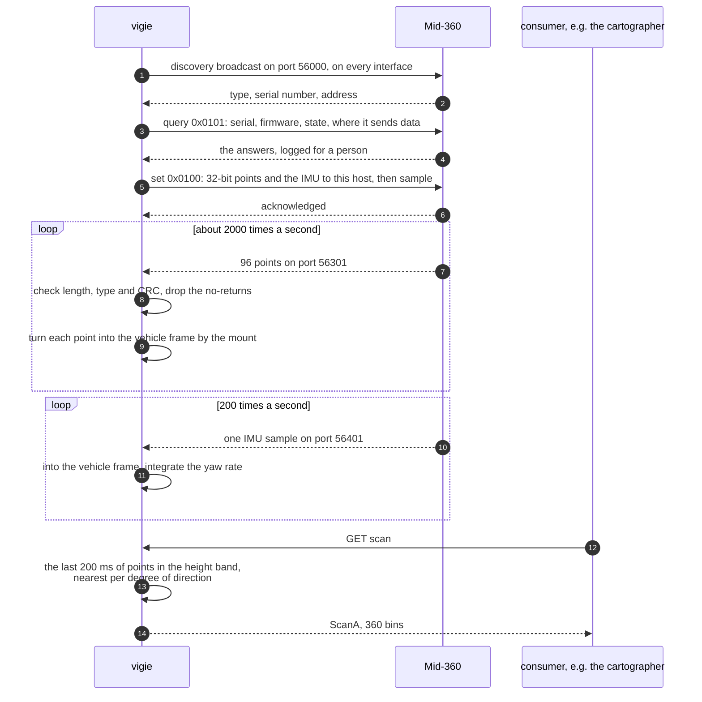

# vigie

*The lookout at the masthead.* A Livox Mid-360 3D lidar, with the IMU built into
it, as an Arrowhead unit asset: the system that gives a vehicle a view all round.

Like the [guetteur](../guetteur) it is the sensor and nothing more. It knows the
lidar's network protocol and where on the vehicle the lidar is mounted, and it
publishes what a consumer can act on. It does not map and it does not drive.

> **Not yet run against the device.** It is written from Livox's published
> protocol and checked against the Livox-SDK2 source where the prose leaves a
> detail open. Every packet format, both checksums and the command exchange are
> tested against frames built from the specification, against a simulator that
> produces real packets, and against a fake lidar on the loopback interface. The
> guetteur's first version was written the same way and was wrong until it met
> the sensor; expect the same here, and see [the first run](#the-first-run).

## Services

| service | form | what it is |
|---|---|---|
| `scan` | `ScanA_v1a` | a 360° horizontal scan: in each 1° of direction, the nearest return in a band of heights — the form the guetteur speaks, so the cartographer reads it as it is |
| `clearance` | `SignalA_v1a` | the nearest return in the corridor the vehicle will drive through, at any height it could hit, in meters forward of the reference point |
| `yawrate` | `SignalA_v1a` | the rate of turn about the vertical, rad/s, positive to the left |
| `heading` | `SignalA_v1a` | the yaw rate integrated since start, degrees. It drifts and never wraps; it is for comparing with the wheels, not for steering by |
| `pitch` / `roll` | `SignalA_v1a` | the tilt from gravity, degrees: pitch positive nose down, roll positive right side down (ISO 8855) |
| `quality` | `SignalA_v1a` | the share of the last window's beams that came back, percent |

Everything is in the **vehicle frame**, ISO 8855 as everywhere on the Artitrax:
x forward, y to the left, z up, its origin on the ground below the reference
point the mount is measured from. When the cartographer reads the vigie's
`scan`, its `scannerMount` is therefore zero: the vigie has already moved the
scan to the reference point.

**`clearance` answers 503, not a distance, when nothing came back from the
corridor ahead**, for the guetteur's reason: a lidar that saw nothing there
cannot say whether the way is clear or it was blind, and every number is a
distance somebody will act on. `quality` says which. In a straight drift longer
than the lidar's range this means `clearance` is unavailable while the way is in
fact clear; a consumer has to treat that as "cannot see", which is the safe
reading and the one this system can stand behind.

## From the lidar to a scan

**Why a window and not a frame.** The Mid-360 does not sweep lines; it covers its
field of view gradually, in a pattern that never repeats. A tenth of a second of
points is sparse, so a scan is made from the last `accumulateMs`, 200 ms by
default. At walking pace the vehicle moves about 25 cm in that time, and the
points are not corrected for it; the same is true of the guetteur's sweep.

## The first run

On the computer the lidar is wired to:

1. **Network.** The lidar's address is `192.168.1.1XX`, the last two digits of
   its serial number. The port it is plugged into needs an address on
   `192.168.1.x`; Livox's instructions use `192.168.1.50`.
2. **Probe.** `./vigie -probe` broadcasts a discovery request on every
   interface, and prints what the lidar says about itself — serial number,
   firmware, working state, temperature, diagnostic status, and where it is
   sending its points and IMU samples — **without changing anything**.
   `./vigie -probe -lidar 192.168.1.1XX` asks a known address instead.
3. **Record.** `./vigie -record run1.vigie` runs the system and writes every
   datagram it receives to a file. Drive or carry it a little. That file can be
   replayed anywhere (`"source": "replay"`, `"replayFile": "run1.vigie"`), and is
   what the parser is tested against before anyone trusts it on the vehicle.
4. **Look at the log.** Every ten seconds the vigie says what arrived and what
   it refused. If two hundred well-formed packets in a row fail the checksum, it
   says that loudly: the data checksum is the one detail Livox's own SDK never
   checks, so it is the one most likely to differ from the document. Look at a
   recording before setting `checkDataCRC` to `false`.

**The configuration is written to the lidar and kept there.** With `configure`
true (the default) the vigie tells the lidar to send its data to this host. A
ROS driver or Livox Viewer elsewhere would then stop receiving it. Set
`configure` to false to only listen, when something else configures the lidar.

## Configuration

| field | default | |
|---|---|---|
| `source` | `simulated` | `livox`, `simulated` (a tunnel, with real packets), or `replay` |
| `replayFile` | | a recording made with `-record` |
| `lidarIP` | | the lidar's address; empty finds it by broadcast |
| `configure` | true | point the lidar's data at this host, and set it sampling |
| `checkDataCRC` | true | check the CRC-32 on every point and IMU packet |
| `mount` | z 1.0 m | where the lidar is, from the reference point on the ground, and how it is turned: `xMetres`, `yMetres`, `zMetres`, `rollDegrees`, `pitchDegrees`, `yawDegrees` |
| `body` | none | the vehicle's own outline, `minX`…`maxY` in meters, whose returns are ignored |
| `slice` | 0.3–1.5 m, 1°, 0.2–40 m, 200 ms | the band of heights, bin width, ranges and window that make the scan |
| `clearance` | ±0.45 m, 0.1–1.6 m | the corridor ahead: half its width, and the heights the vehicle could hit |
| `imuAverageMs` | 100 | the window the IMU's readings are averaged over |
| `staleAfterMs` | 1000 | how old the newest data may be before the services stop answering |

**The mount assumes the Mid-360's own frame is x forward, y left, z up**, as
Livox draws it. That has not been checked on the vehicle. The quickest check is
`pitch` and `roll` with the vehicle level — both near zero — and `scan` with a
person standing in front of it, at 0°.

## Not here yet

- **The articulation.** The `body` box is fixed, and the Artitrax bends in the
  middle: the other half of the vehicle moves through the lidar's view as the
  waist turns. Until the vigie reads the loader's `articulation`, set the box to
  the half the lidar is on, and expect the other half in the scan when turning.
- **Choosing between scanners.** The cartographer takes any provider of `scan`.
  With the guetteur and the vigie both running it takes whichever the
  orchestrator offers; it needs a setting naming the one it wants.
- **The point cloud itself.** About 200 000 points a second stays on board; a
  reduced cloud form can come when a consumer needs one.
- **Time synchronization.** The lidar supports PTP. Its timestamps are used
  only to integrate the yaw rate; everything else is stamped on arrival.
